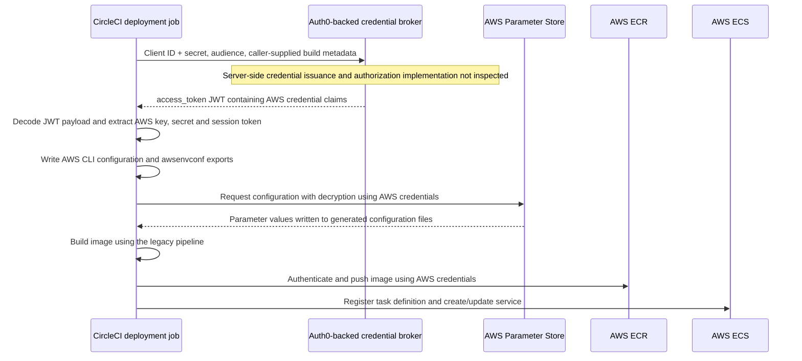
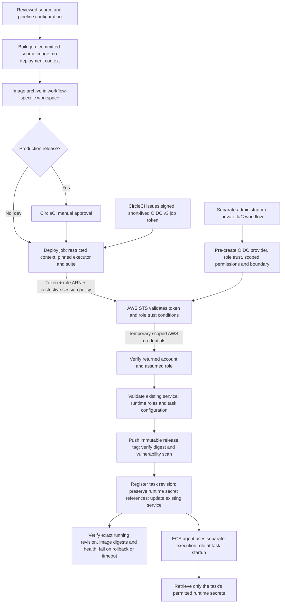

# Topcoder deployment scripts v2

Deploy prebuilt images to an **existing** ECS/Fargate service without giving the deployment role access to Parameter Store or Secrets Manager. CircleCI OIDC v3 exchanges a short-lived job identity for an AWS STS session; the Auth0 client-secret broker is no longer used.

**This is a breaking migration, not a drop-in v1 patch.** Do not repoint existing v1 tags. Pipelines that source `awsenvconf`, `deployvar_env`, or `buildvar_env` must migrate with their IAM roles. Old interfaces fail before network calls. EBS, S3, Lambda and secret-provisioning modes are not supported in v2. Historical `direct/` assets are outside the v2 deployer.

Read [the migration guide](docs/MIGRATION.md), [the Auth0/AWS explanation](docs/AUTHENTICATION.md), and [the 19-service adoption checklist](docs/SERVICES.md) before testing.

## Deployment flow: before and after

These diagrams compare the legacy ECS path in `1.4.*` (using `v1.4.21` as the source reference) with the default ECS deployment in `2.0.9`. Service-specific migration/CloudFormation adapters add their reviewed steps; Platform UI uses its own S3/CloudFront adapter.

### Before: 1.4.* — broker credentials returned to CircleCI



The broker handled credential delivery, but CircleCI held the returned AWS credentials and made the AWS deployment calls itself. The client code decoded the broker JWT payload without verifying its signature, and the broker request used `curl -k`. The broker's internal AWS exchange and independent authorization checks are not established by this client code. Sources: [credential request, extraction and export](https://github.com/topcoder-platform/tc-deploy-scripts/blob/v1.4.21/awsconfiguration.sh#L19-L39), [parameter retrieval](https://github.com/topcoder-platform/tc-deploy-scripts/blob/v1.4.21/psvar-processor.sh), and [ECS deployment](https://github.com/topcoder-platform/tc-deploy-scripts/blob/v1.4.21/master_deploy.sh#L583-L623).

### After: 2.0.9 — direct CircleCI OIDC with pre-provisioned IAM



AWS trust restricts the accepted CircleCI identity by issuer/audience, project, checkout repository/ref and configuration repository/ref. The script and role ARN are not credentials. The STS session policy restricts the session; it does not install IAM policies or create roles. `tcdeploy.py` has no `policies` command in `v2.0.9`. Deployment roles and boundaries explicitly deny Parameter Store, Secrets Manager, KMS decryption and role chaining; runtime retrieval uses the separate ECS execution role.

Production approval is enforced by the protected CircleCI workflow and context controls, not inferred by AWS from a token. Signed tokens and temporary AWS credentials still require protection: a stolen valid token or compromised authorized job can exercise the access it is allowed. See [authentication and trust boundaries](docs/AUTHENTICATION.md) for details.

## Requirements

- A reviewed, digest-pinned Linux executor containing Python >=3.10 with the `tarfile` extraction-filter security backport, AWS CLI v2, Docker/Buildx, Git and system CA certificates. No package installation in the credential-bearing job. This deployer has no external Python dependencies.
- CircleCI Cloud with `CIRCLE_OIDC_TOKEN_V3`, protected exact development (`develop` or `dev`) and production (`master` or legacy `prod`) refs, and restricted deployment contexts containing no broker/static AWS credentials.
- Separate per-service/per-environment deploy, task and execution roles, and a reviewed non-secret manifest.
- Existing immutable ECR repositories with scan-on-push, ECS circuit-breaker rollback, positive desired capacity, explicit task health checks (or a reviewed first-deployment health-check file), and pre-provisioned runtime secret references.

## Usage

Copy `examples/deploy.dev.json` / `examples/deploy.prod.json` into the service repository and replace the example identifiers with administrator-verified values. These are placeholders, not guessed Topcoder targets.

The OIDC provider, deployment roles, trust policies, permissions and boundaries must already be installed through a separately reviewed administrator/IaC workflow. Their service-specific definitions live in the private [v6-services-iac repository](https://github.com/topcoder-platform/v6-services-iac/tree/main/services), under `services/<repository>/deploy/iam/`. Application CI must not fetch that repository or provision IAM. Secret/KMS read permissions belong on the narrowly scoped execution role, never the deployment role.

`tcdeploy.py` exposes only `deploy` and `check-auth`; it does not generate or install IAM policies. Its STS session policy only restricts the temporary session within the existing role's permissions and boundary. It cannot grant new role permissions or change trust.

From the service checkout, in a build job without deployment context:

```sh
python3 -I /tmp/tc-deploy-scripts/build_image.py --image example-v6:candidate
docker save --output /tmp/image.tar example-v6:candidate
```

The helper builds `git archive HEAD` in a temporary context, rejects credential/secret-file inputs and symlinks, accepts PEM files only when they contain public certificates, strips credentials from subprocess environments, and provides no secret/build-argument options. For nested Dockerfiles use `--dockerfile docker/Dockerfile`; for a sidecar use `--dockerfile clamav/Dockerfile --context clamav`. `--target migrate` can build a migration image; executing migrations remains a separately controlled operation.

In a separately authorized deploy job, load the workflow-specific image archive, then:

```sh
/tmp/tc-deploy-scripts/awsconfiguration.sh --manifest deploy/dev.json
/tmp/tc-deploy-scripts/master_deploy.sh --manifest deploy/dev.json \
  --image example-v6=example-v6:candidate
```

`awsconfiguration.sh` is an optional identity check, not a credential exporter. `master_deploy.sh` authenticates internally. Neither writes AWS credentials to the checkout/default profile, logs, or shell exports. Use the entire SHA-pinned suite, not the old four copied shell files. See `examples/circleci-v2.yml`; replace its explicit executor/commit placeholders before use.

The deployer verifies account/role, live service configuration, source label, ECR immutability, local/remote configuration digest, a scan completed within 24 hours with no MEDIUM/HIGH/CRITICAL/UNDEFINED findings, and the exact healthy running revision/digests. By default only selected images change; roles, secret references, sidecars, resources, volumes and existing health checks remain intact. Non-root runtime images are required and `RESET_DB` cannot be enabled. The source label is a consistency check, not cryptographic build provenance; protect the pipeline and artifact writers.

Payload's reviewed dev adapter may explicitly construct `Publisher(..., scan_policy='payload-dev-high-critical')`. This policy reports the validated severity counts and allows MEDIUM findings while still blocking HIGH, CRITICAL and UNDEFINED findings. It is accepted only for `topcoder-platform/payload-cms`, environment `dev`, branch `develop`, and the exact Payload service, task family and image mapping. Other repositories and production cannot select it. The default remains strict, and there is no CLI flag or environment-variable override. Scan completion, freshness, response validation and artifact verification still apply; IAM permissions do not change.

For an existing service whose task definition has no health check, add a reviewed container-to-check JSON file in the application repository and pass `--bootstrap-health-checks deploy/dev-healthcheck.json`. The deployer adds the missing check in the same task revision as the new, scanned image. It never starts the old image with the new check, and never replaces a different existing check. Matching existing checks are accepted on later releases. Checks must use an explicit `CMD` argument list; all normal identity, configuration, scan, concurrency, readback, and healthy-running-digest gates still apply. This adds no IAM permissions. ECS circuit-breaker rollback retains the previous task revision; a rollback still fails the release.

Plaintext runtime credentials remain forbidden. The specific public settings `M2M_TOKEN_ISSUER`, `M2M_TOKEN_AUDIENCE`, and `HUMAN_TOKEN_ISSUER` may contain HTTPS URLs without user information, query strings, or fragments; `TOKEN_CACHE_TIME` may contain an unsigned integer up to 2147483647. Other secret-like names still fail preflight. These exceptions preserve public application metadata and do not fetch tokens or grant access to secret stores.

ECR may omit its optional severity-count map for a clean image. That response is accepted only after the same completion/freshness checks, with an exact registry/repository/digest match, explicitly empty findings lists, and no remaining page. An absent summary without that evidence, nonempty findings without a summary, or malformed counts fails closed. This requires no additional IAM permissions or changes to registry scanning. See the [ECR response schema](https://docs.aws.amazon.com/AmazonECR/latest/APIReference/API_ImageScanFindings.html).

Enhanced scanning also requires `inspector2:ListFindings` and `inspector2:ListCoverage` in the deployment role, its permissions boundary, and the STS session policy. The administrator-installed role policy and boundary must limit these read-only actions to the deployment region. AWS does not support repository-level resource restrictions for these Inspector list actions, so they can read account-wide scan metadata in that region. No Inspector configuration/write actions or parameter/secret access are granted. Existing roles and boundaries must be updated through the private infrastructure repository before adopting this change. See [AWS enhanced-scanning permissions](https://docs.aws.amazon.com/AmazonECR/latest/userguide/image-scanning-enhanced-iam.html).

Use a unique CircleCI build number when retrying publication to immutable tags. ECR can return multiple image records when several tags share one digest; publication verification resolves the exact immutable release tag and checks its returned tag, image digest and configuration digest before scanning. A failed rollout remains a failure even if ECS rolls back. The script never blindly reverts over another deployment.

## Tests

```sh
python3 -m unittest discover -s tests -v
```

Tests mock cloud API calls and Docker and require no credentials, account, network or external Python packages. An offline AWS CLI parsing test runs when the CLI is installed; CI also runs the suite inside the pinned CircleCI executor with networking disabled. Passing these tests does not replace IAM simulation and a real dev rollout. GitHub CI runs them with read-only repository permissions.

Subprocess input uses an anonymous Linux memory file so AWS CLI can reopen `file:///dev/stdin` during JSON parsing. Tokens and request bodies stay out of command arguments and named filesystem files; the input descriptor closes on success or failure. Regression tests exercise repeated reads using a real subprocess.
